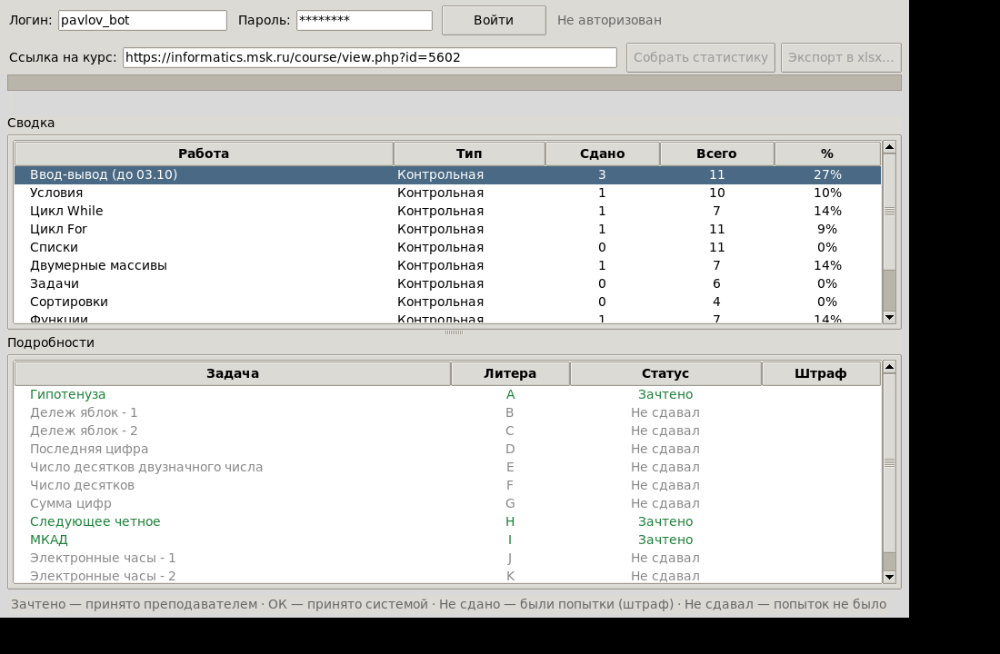
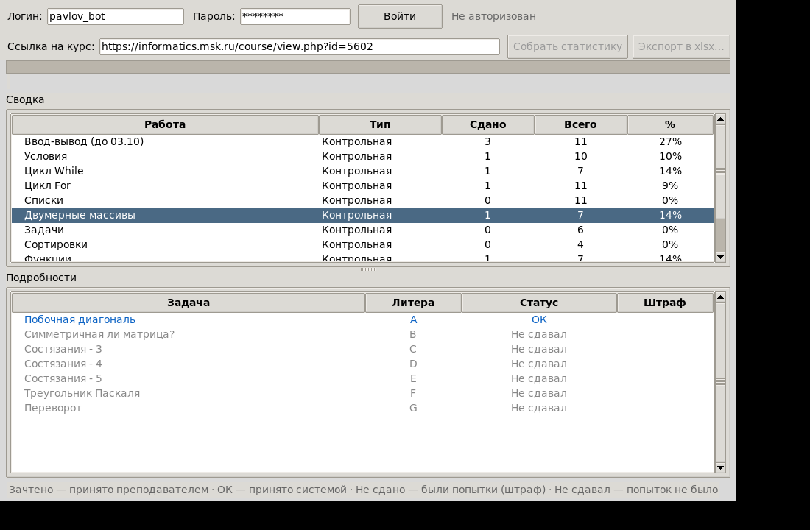
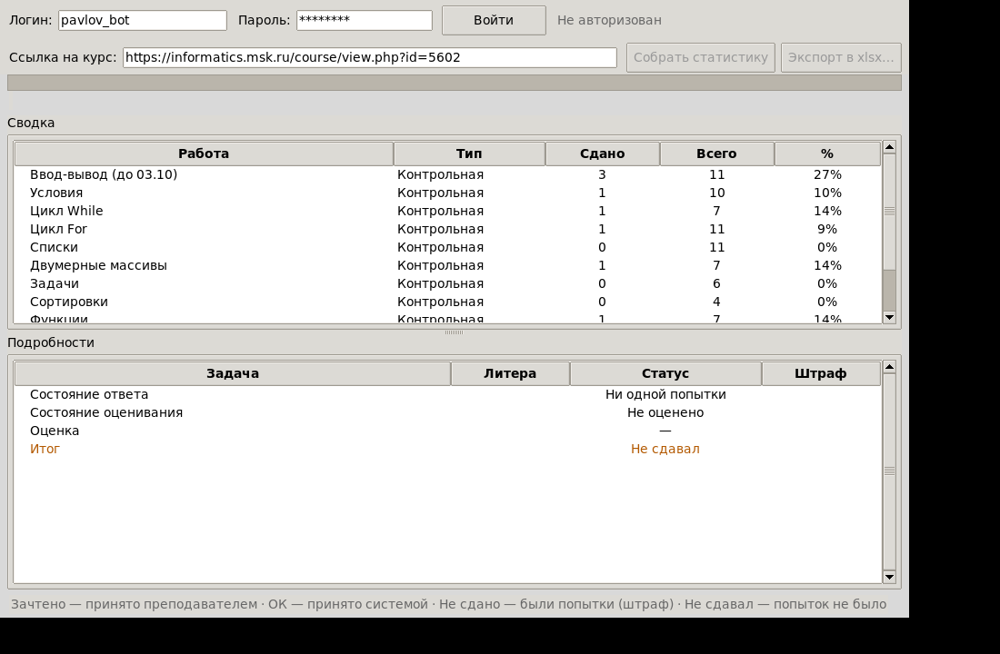

# Моя статистика — informatics.msk.ru (студент)

Приложение для **студента**: подробная личная статистика по сдаче задач
на [informatics.msk.ru](https://informatics.msk.ru). Студент видит
**только свои** результаты: какие задачи сданы, какие ещё нет, что
принято системой (**ОК**) и что зачтено преподавателем (**Зачтено**).

Пара к преподавательскому монитору
[informatics_parse_new](https://github.com/PavlOV98/informatics_parse_new);
общий принцип работы — тот же (HTTP + разбор страниц, без браузера и
Selenium).

## Внешний вид







## Возможности

* вход на informatics.msk.ru по логину и паролю;
* указание **ссылки на курс** (`course/view.php?id=…`) — программа сама
  находит на странице курса все списки задач (`mod/statements`) и
  задания на проверку (`mod/assign`);
* сбор таблиц результатов (`/py/monitor`) и страниц заданий, разбор
  статусов **только своей** строки/блока;
* подробная статистика по каждой задаче:

  | Статус | Значение |
  |---|---|
  | **Зачтено** | клетка зелёная — принято (зачтено) преподавателем вручную |
  | **ОК** | клетка жёлтая — принято проверяющей системой |
  | **Не сдано** | были попытки со штрафом, задача не зачтена |
  | **Не сдавал** | попыток не было |
  | **Нет в таблице** | студент не найден в таблице результатов |

* по заданиям `assign` — состояние ответа («Ни одной попытки»,
  «Отправлено на проверку», …), состояние оценивания и оценка;
* сводка «сдано / всего / %» по каждой работе курса;
* экспорт в **xlsx**: лист «Сводка» и лист «Задачи» с цветовой
  раскраской по статусам;
* CLI-версия для печати статистики в консоль.

## Установка

Нужен Python 3.9+ и библиотеки:

```bash
pip install requests beautifulsoup4 lxml openpyxl
```

## Запуск (графический интерфейс)

```bash
python3 student_gui.py
```

1. Введите логин и пароль от informatics.msk.ru, нажмите **«Войти»**.
2. Укажите ссылку на курс, например
   `https://informatics.msk.ru/course/view.php?id=5602`.
3. Нажмите **«Собрать статистику»** — дождитесь окончания.
4. В верхней таблице — сводка по работам; клик по строке покажет
   подробный список задач со статусами и штрафами.
5. **«Экспорт в xlsx…»** — сохранить статистику в файл.

Логин/пароль/ссылка на курс запоминаются в `config.json`
(файл не попадает в репозиторий).

## Запуск (командная строка)

```bash
python3 main.py --login логин --password пароль \
    --course https://informatics.msk.ru/course/view.php?id=5602 \
    --out статистика.xlsx
```

Без аргументов используются значения из `config.json`.

## Как это работает

| Шаг | Запрос |
|---|---|
| Вход | `GET /login/index.php` (берётся `logintoken`) → `POST /login/index.php` |
| Кто я | id и ФИО студента берутся из главной страницы после входа; строка в таблице ищется сначала по `user_id`, при несовпадении — по ФИО |
| Список работ курса | `GET /course/view.php?id=NNN` — ссылки `mod/statements/view.php?id=…` (контрольные) и `mod/assign/view.php?id=…` (задания) |
| Результаты контрольной | `GET /py/monitor?contest_id=<id статьи>` — таблица; из строки студента читаются клетки задач: `+`/`+N` (цвет: жёлтая — ОК, зелёная — зачтено), `-N`/красная — попытки со штрафом, пустая — не сдавал |
| Задание assign | `GET /mod/assign/view.php?id=NNN` — блок `div.submissionstatustable` («Состояние ответа», «Состояние оценивания», оценка) |

Файлы:

* `student_api.py` — клиент сайта и разбор статусов;
* `student_gui.py` — окно приложения (tkinter);
* `xlsx_export.py` — экспорт в Excel;
* `main.py` — CLI-версия;
* `config.example.json` — образец настроек.

## Замечания

* Статистика собирается **только по вашей учётной записи**; чужие
  строки таблиц не сохраняются и не показываются.
* Если у человека и бота/второго аккаунта одинаковое ФИО, поиск строки
  по имени может выбрать не ту учётную запись — сверяйте id в заголовке
  окна после входа.
* Соблюдайте разумную частоту запросов (`request_delay_sec` в
  `config.json`, по умолчанию 0.5 с).

## Лицензия

MIT.
